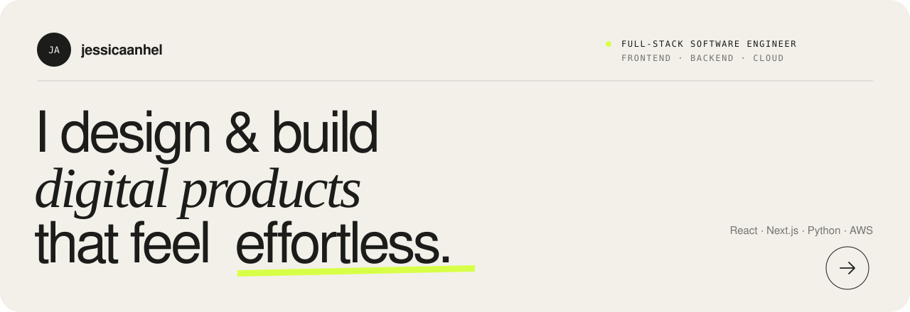
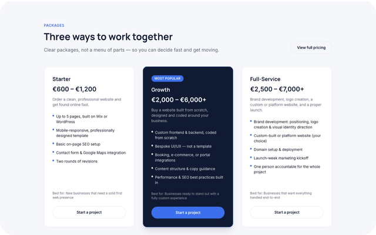
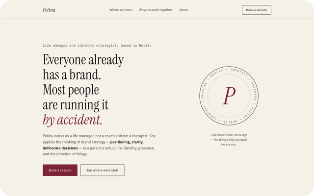
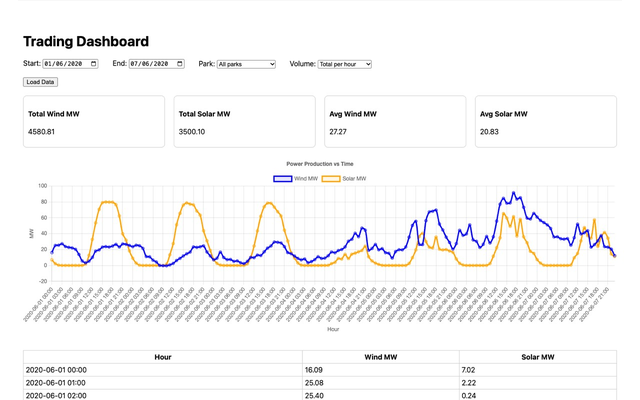
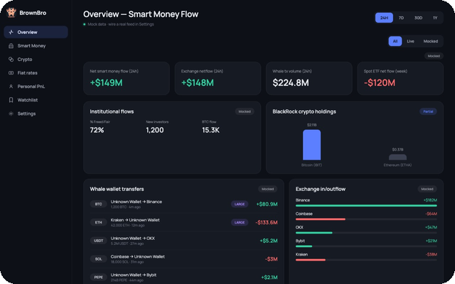
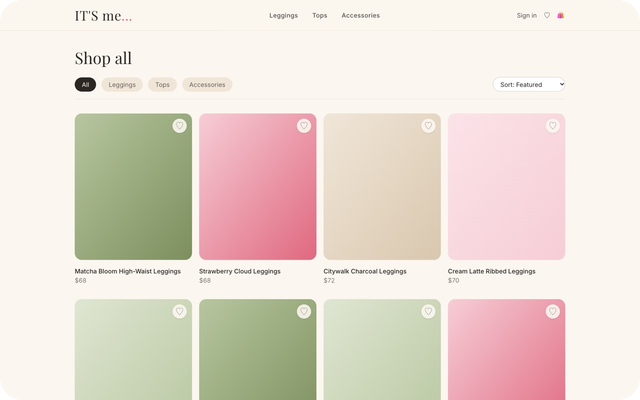
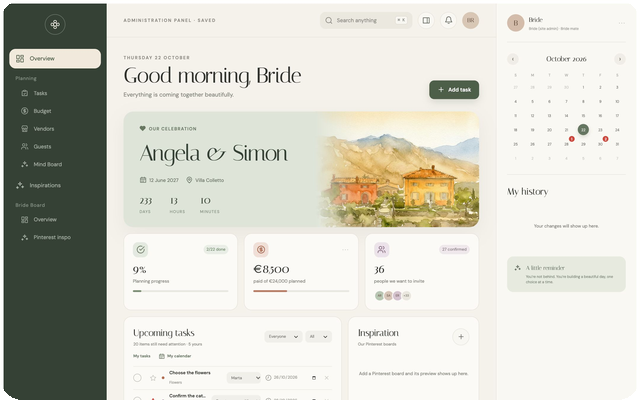

<a href="https://jessicaanhel.github.io/jessicaanhel/">
  <picture>
    <source media="(prefers-color-scheme: dark)" srcset="assets/banner-dark.svg">
    
  </picture>
</a>

  
  &nbsp;
  

### About

Full-stack software engineer. I build React and Next.js frontends, Python APIs on AWS,
and dashboards that make data easy to read. I like working on both sides of the screen:
the interface people touch, and the API, data and deployment behind it.

### Selected work

<table>
  <tr>
    <td width="33%" valign="top">
      
       <b>Northline Digital</b>
       Marketing website · React, Vite, Tailwind
    </td>
    <td width="33%" valign="top">
      
       <b>Polina Berlin</b>
       Personal website · HTML, CSS
    </td>
    <td width="33%" valign="top">
      
       <b>Energy trading dashboard</b>
       Dashboard · FastAPI, AWS Lambda, Next.js
    </td>
  </tr>
  <tr>
    <td width="33%" valign="top">
      
       <b>Analytics dashboard</b>
       Dashboard · React, Flask
    </td>
    <td width="33%" valign="top">
      
       <b>IT'S me… shop</b>
       Online shop · Next.js, Zustand
    </td>
    <td width="33%" valign="top">
      
       <b>Wedding planning panel</b>
       Web app · Next.js, Google Sheets
    </td>
  </tr>
</table>

### Stack

<picture>
  <source media="(prefers-color-scheme: dark)" srcset="assets/stack-dark.svg">
  
</picture>
